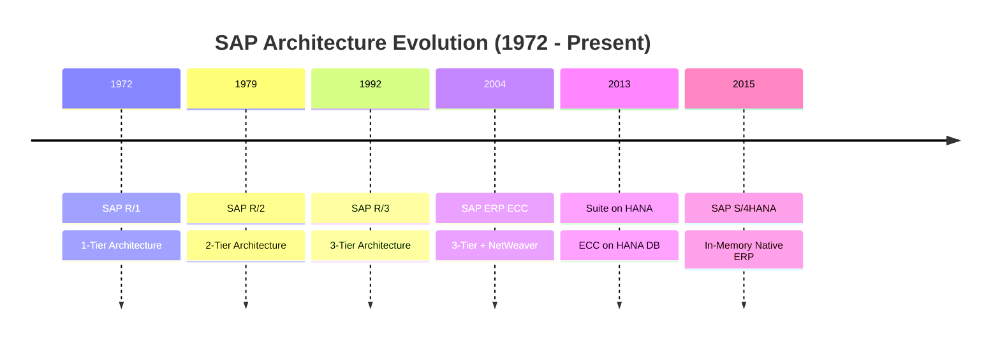
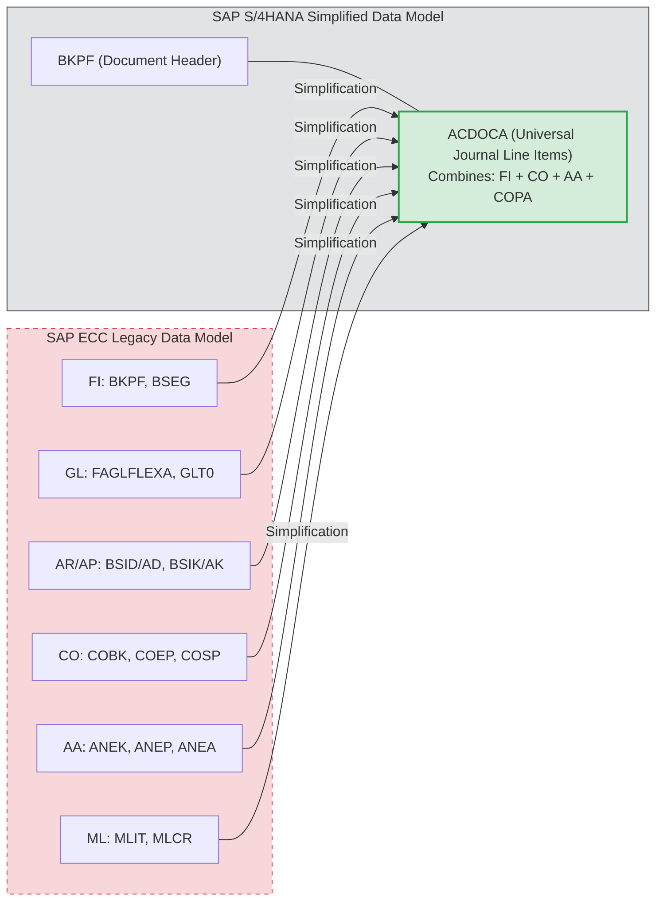
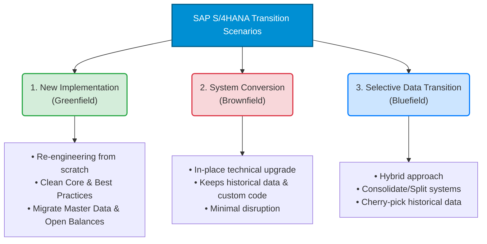
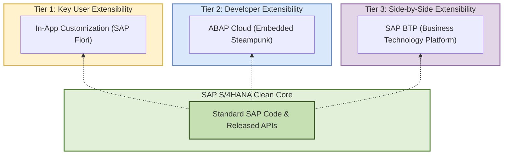

# 📘 الدليل المرجعي الشامل لمعمارية وتاريخ وإصدارات SAP S/4HANA

  
  
  

 

**مرجع هندسي واستشاري لمستشاري ساب — Functional & Technical Consultants**

---

## 🧭 خريطة التنقل السريع

| المسار | القسم | الملخص السريع |
| :--- | :--- | :--- |
| **🏛️ التأسيس** | **01.** [ماهية وتسمية SAP S/4HANA](#-1-نظرة-عامة-ما-هو-sap-s4hana-ولماذا-سُمي-بهذا-الاسم) | تفكيك الاسم وفلسفة الحوسبة الفورية |
| **🏛️ التأسيس** | **02.** [تطور أجيال ساب التاريخي](#-2-التطور-التاريخي-والمعماري-لأنظمة-sap) | الرحلة المعمارية من `R/1` حتى `S/4HANA` |
| **🏛️ التأسيس** | **03.** [أهمية فهم إرث SAP ECC](#-3-لماذا-يجب-على-المستشار-فهم-تاريخ-النسخ-السابقة-ecc) | لماذا نحتاج فهم النظام القديم في المشاريع والمقابلات؟ |
| **⚙️ المعمارية** | **04.** [الفروق الجذرية بين ECC و S/4HANA](#-4-التحول-الجذري-في-هيكل-البيانات-والعمليات) | جدول `ACDOCA` وشريك الأعمال `BP` وإلغاء الجداول الوسيطة |
| **⚙️ المعمارية** | **05.** [مقارنة بيئات التشغيل الثلاث](#-5-مقارنة-شاملة-لبيئات-التشغيل-on-premise-vs-private-vs-public) | الفروق بين `On-Premise` و `Private Cloud` و `Public Cloud` |
| **⚙️ المعمارية** | **06.** [الحزم التجارية RISE و GROW](#-6-الحزم-الاستراتيجية-الفرق-بين-rise-with-sap-و-grow-with-sap) | الفروق التعاقدية والتقنية ومتى تختار الشركات كل حزمة |
| **🚀 التنفيذ** | **07.** [مسارات الانتقال والتحول](#-7-مسارات-الانتقال-والتحول-transition-scenarios) | مقارنة منهجيات `Greenfield` و `Brownfield` و `Bluefield` |
| **🚀 التنفيذ** | **08.** [فلسفة النواة النظيفة Clean Core](#-8-فهم-فلسفة-clean-core-ومنهجية-التوسع) | معايير التطوير الحديثة وبناء الإضافات عبر منصة `SAP BTP` |
| **🚀 التنفيذ** | **09.** [إستراتيجية الإصدارات والتحديثات](#-9-دليل-قراءة-إصدارات-sap-ونشرات-التحديث) | قراءة أكواد `FPS` و `SPS` واستخدام أداة `What's New Viewer` |

---

## 🔍 1. نظرة عامة: ما هو SAP S/4HANA ولماذا سُمي بهذا الاسم؟

يمثل نظام **SAP S/4HANA** الجيل الرابع من أنظمة تخطيط موارد المؤسسات التي طورتها شركة ساب، وهو أكبر إعادة صياغة برمجية ومعمارية للنظام منذ إطلاق الجيل الثالث في أوائل التسعينيات.

### تفكيك الاسم الرسمي: `SAP Business Suite 4 SAP HANA`

* **الحرف `S` — يرمز إلى التبسيط `Simple`:**
  الهدف الأساسي هو تبسيط هيكل جداول البيانات بإزالة الجداول الوسيطة والمكررة، وتبسيط تجربة المستخدم عبر شاشات **SAP Fiori** الحديثة.
* **الرقم `4` — يرمز إلى الجيل الرابع `Fourth Generation`:**
  يمثل التسلسل التاريخي للنظام كجيل رابع بعد الأجيال الثلاثة السابقة وهي `R/1` ثم `R/2` ثم `R/3 & ECC`.
* **المصطلح `HANA` — اختصار `High-Performance Analytic Appliance`:**
  هي قاعدة البيانات الثورية الخاصة بشركة ساب، وتعتمد على المعالجة داخل الذاكرة العشوائية `In-Memory Computing` والتخزين العمودي للبيانات `Columnar Store` بدلاً من التخزين الأفقي التقليدي.

> **💡 قاعدة معمارية مهمة:**
> الأنظمة السابقة مثل `R/3` و `ECC` كانت تعمل بمبدأ **`AnyDB`**، أي يمكن تثبيتها على قواعد بيانات مختلفة مثل `Oracle` أو `SQL Server` أو `IBM DB2`. أما نظام **SAP S/4HANA فلا يعمل إلا حصرياً على قاعدة بيانات SAP HANA**؛ لأن الكود البرمجي أُعيدت كتابته ليتم تنفيذ العمليات الحسابية الثقيلة داخل طبقة قاعدة البيانات مباشرة، وهو ما يُعرف هندسياً بمبدأ **`Code Pushdown`**.

---

## ⏳ 2. التطور التاريخي والمعماري لأنظمة SAP

تأسست شركة ساب في ألمانيا عام **1972** على يد خمسة مهندسين سابقين في شركة IBM، وتطورت أنظمتها عبر المحطات المعمارية التالية:

| الجيل والإصدار | سنة الإطلاق | المعمارية التقنية | الخصائص الجوهرية للنظام |
| :--- | :--- | :--- | :--- |
| **SAP R/1** | `1972` | **`1-Tier Architecture`** خادم مركزي `Mainframe` | يرمز حرف `R` إلى المعالجة الفورية `Real-Time`. كانت شاشة العرض ومنطق التطبيق وقاعدة البيانات تعمل جميعها في طبقة واحدة. |
| **SAP R/2** | `1979` | **`2-Tier Architecture`** خادم مركزي `Mainframe` | فصل جزئي بين الطبقات، وصُمم لدعم الشركات الكبرى متعددة الجنسيات واللغات والعملات عبر واجهات نصية تقليدية. |
| **SAP R/3** | `1992` | **`3-Tier Architecture`** معمارية `Client / Server` | نقلة تاريخية فصلت النظام إلى 3 طبقات مستقلة: 1. طبقة العرض عبر `SAP GUI` 2. طبقة التطبيقات بلغة `ABAP` 3. طبقة قاعدة البيانات العلائقية `RDBMS` |
| **SAP ERP ECC** | `2004` | **`3-Tier + NetWeaver`** أشهرها إصدار `ECC 6.0` | اختصار `ERP Central Component`، وصدر له ثماني حزم تحديث `EhP 1` حتى `EhP 8` مع دعم البنية الخدمية `SOA`. |
| **Suite on HANA** | `2013` | **`ECC on HANA DB`** مرحلة انتقالية `SoH` | تشغيل كود نظام `ECC` القديم كما هو على قاعدة بيانات `SAP HANA` الجديدة التي ظهرت عام 2010 دون تغيير جوهري في الجداول. |
| **SAP S/4HANA** | `2015` | **`In-Memory Native ERP`** `Fiori + ABAP + HANA` | إعادة كتابة شاملة للتطبيقات لإلغاء جداول الإجماليات والمؤشرات، ودمج العمليات التشغيلية والتحليلية معاً `OLTP + OLAP`. |

---

## 💡 3. لماذا يجب على المستشار فهم تاريخ النسخ السابقة ECC؟

حتى لو كنت تبدأ مسيرتك المهنية اليوم على أحدث إصدار من S/4HANA، فإن الإلمام بنظام **SAP ECC** وكيف تطور يُعد ضرورة عملية لثلاثة أسباب:

1. **مشاريع التحول والترقية — `System Conversion / Brownfield`:**
   أغلب الشركات الكبرى حول العالم كانت تستخدم نظام `ECC`، ومع انتهاء الدعم القياسي له في **نهاية عام 2027** وانتهاء الصيانة الممتدة في **2030**، فإن نسبة كبيرة من المشاريع الحالية في السوق هي مشاريع انتقال من `ECC` إلى `S/4HANA`.
2. **التواصل مع المستخدمين القدامى والمديرين الماليين — `Key Users & CFOs`:**
   المستخدم الخبير الذي عمل لسنوات على النظام القديم سيتحدث معك بمصطلحات وشاشات `ECC`، كأن يسألك عن سبب اختفاء شاشات `FD01` و `FK01` أو شاشة إنشاء عناصر التكلفة `KA01`.
3. **اجتياز المقابلات الشخصية — `Consultant Interviews`:**
   السؤال الأساسي في أي مقابلة عمل لمستشار ساب هو: **ما هي الفروقات الجوهرية في موديولك بين ECC و S/4HANA؟** وهي الفروقات الموثقة رسمياً في قائمة التبسيط **`Simplification List`**.

---

## 🔄 4. التحول الجذري في هيكل البيانات والعمليات

### أولاً: دمج العمليات اليومية والتحليلية `OLTP + OLAP`

في قواعد البيانات التقليدية التي تخزن البيانات على الأقراص الصلبة بشكل أفقي، كانت قراءة ملايين الأسطر لحساب رصيد عميل أو حساب عام عملية بطيئة. لذلك اضطر نظام **ECC** إلى إنشاء:
* **جداول إجماليات مسبقة — `Totals Tables`:** مثل جدولي `GLT0` و `FAGLFLEXT` لتخزين الأرصدة الشهرية جاهزة.
* **جداول مؤشرات ثانوية — `Secondary Index Tables`:** مثل `BSIS` و `BSAS` للحسابات العامة، و `BSID` و `BSAD` للعملاء، و `BSIK` و `BSAK` للموردين.

في نظام **S/4HANA**، وبفضل سرعة الذاكرة العشوائية والتخزين العمودي، يتم جمع ملايين السجلات لحظياً أثناء طلب التقرير `On-the-fly Aggregation`، مما سمح بحذف الجداول الوسيطة والاعتماد على جدول مركزي واحد كمصدر وحيد للحقيقة `Single Source of Truth`.

### ثانياً: مقارنة التغييرات الوظيفية الكبرى في الموديولات الأساسية

| المحور الوظيفي | الوضع القديم في SAP ECC | الوضع الحديث في SAP S/4HANA | الأثر المباشر على عمل المستشار |
| :--- | :--- | :--- | :--- |
| **القيود المالية والتكاليف** `FI & CO Journal` | جداول منفصلة للمالية `BSEG` والتكاليف `COEP`، مما يتطلب تسويات دورية بين الموديولين. | **`ACDOCA` — Universal Journal** دمج كامل في جدول موحد يستوعب حتى 999,999 سطر في القيد الواحد بدلاً من 999 سطر في السابق. | تطابق لحظي بنسبة 100% بين المالية والتكاليف دون الحاجة لتسويات نهاية الشهر. |
| **عناصر التكلفة** `Cost Elements` | تُنشأ في شاشات مستقلة عن شجرة الحسابات عبر كود `KA01` للأولية وكود `KA06` للثانوية. | **مدمجة داخل شاشة `FS00`** أصبحت جزءاً من البيانات الأساسية للحساب العام `G/L Master Data` عبر تحديد نوع الحساب. | توحيد شجرة الحسابات المالية مع عناصر التكاليف الأولية والثانوية في شاشة إعداد واحدة. |
| **العملاء والموردون** `Customer & Vendor` | شاشات وجداول منفصلة تماماً لإنشاء العملاء `FD01 / XD01` والموردين `FK01 / XK01`. | **إلزامية شريك الأعمال `BP`** إلغاء الشاشات القديمة وتوحيدها في شاشة `Business Partner` عبر آلية الربط `CVI`. | سجل رئيسي واحد للشريك يمكن إعطاؤه دور عميل `FLCU00/01` ودور مورد `FLVN00/01` معاً. |
| **حركات المخزون** `MM Inventory` | عشرات الجداول المنفصلة للرأس والتفاصيل والأرصدة مثل `MKPF` و `MSEG` و `MARD` و `MBEW`. | **جدول المخزون الموحد `MATDOC`** دمج حركات المخازن في جدول واحد مع حساب الأرصدة لحظياً دون إغلاق الجداول أثناء الترحيل. | سرعة عالية في ترحيل حركات المواد واستخراج تقارير المخزون اللحظية. |
| **دفتر أستاذ المواد** `Material Ledger` | اختياري، ويتم تفعيله فقط للشركات التي تحتاج تعدد عملات المخزون أو التكلفة الفعلية. | **إجباري التفعيل `Mandatory`** أصبح جزءاً أساسياً لتقييم المخزون وتعدد العملات، بينما بقي حساب التكلفة الفعلية `Actual Costing` اختيارياً. | خطوة كونفيجريشن إلزامية يجب على المستشار تنفيذها عند تعريف أي مصنع `Plant` جديد. |
| **تحليل الربحية** `CO-PA Module` | الاعتماد الشائع كان على نظام `Costing-Based CO-PA` المنفصل عن قيود الأستاذ العام. | **تحليل الهامش `Margin Analysis`** الاعتماد الأساسي على النظام المحاسبي المدمج مباشرة داخل جدول اليومية الموحد `ACDOCA`. | ظهور كافة أبعاد وخصائص الربحية مباشرة على سطر القيد المالي دون فجوات تسوية. |
| **إدارة الائتمان** `Credit Management` | إدارة الائتمان التقليدية التابعة لحسابات العملاء عبر شاشة `FD32`. | **نظام `FSCM Credit Management`** انتقال إجباري إلى موديول إدارة سلسلة التوريد المالية المتقدم. | تغيير كامل في خطوات الكونفيجريشن وإدارة الحدود الائتمانية عبر شاشة شريك الأعمال `BP`. |

---

## ☁️ 5. مقارنة شاملة لبيئات التشغيل: On-Premise vs. Private vs. Public

> **⚠️ تصحيح مفهوم شائع:**
> الاختلاف بين نسخ S/4HANA الثلاث **ليس مجرد مكان وجود السيرفر!** بل يغير طريقة الكونفيجريشن، صلاحيات التعديل البرمجي، مرونة العمليات، ودورية التحديثات الإجبارية.

| وجه المقارنة | S/4HANA On-Premise | S/4HANA Cloud Private Edition | S/4HANA Cloud Public Edition |
| :--- | :--- | :--- | :--- |
| **نموذج الاستضافة** `Hosting Model` | **محلي أو سحابة ذاتية `IaaS`** سيرفرات تديرها الشركة بالكامل. | **سحابة خاصة `Single-Tenant`** بيئة مخصصة لشركة واحدة فقط تديرها ساب. | **سحابة عامة `Multi-Tenant SaaS`** بيئة سحابية تشاركية قياسية لجميع العملاء. |
| **أداة الكونفيجريشن** `Configuration` | **شاشة `SPRO / IMG` الكاملة** تحكم كامل في كافة إعدادات النظام. | **شاشة `SPRO / IMG` الكاملة** مطابقة تماماً لنسخة `On-Premise`. | **منصة `CBC` وشاشات `SSCUIs`** لا يوجد `SPRO`، والإعداد يتم عبر واجهات سحابية محددة. |
| **مرونة العمليات** `Processes` | **مرونة مطلقة** تخصيص كامل للعمليات لتناسب طبيعة الشركة. | **مرونة مطلقة** نفس قدرات التخصيص الكاملة في `On-Premise`. | **التزام قياسي `Fit-to-Standard`** تلتزم الشركة بالعمليات القياسية الجاهزة من ساب. |
| **واجهة المستخدم** `User Interface` | **واجهات `Fiori` + `SAP GUI`** كلاهما متاح للمستخدمين والمستشارين. | **واجهات `Fiori` + `SAP GUI`** كلاهما متاح للمستخدمين والمستشارين. | **واجهات `SAP Fiori` فقط** العمل يتم عبر المتصفح فقط ولا يتاح `SAP GUI` التقليدي. |
| **البرمجة والتوسع** `ABAP & Code` | **صلاحية كاملة** مسموح بكتابة `Classic ABAP` وتعديل الكود. | **صلاحية كاملة مع توجيه `Clean Core`** وصول كامل لطبقة البرمجة مع تفضيل التوسع النظيف. | **ممنوع `Classic ABAP` التقليدي** التوسع يتم حصرياً عبر `ABAP Cloud` ومنصة `SAP BTP`. |
| **سياسة التحديثات** `Upgrades` | **اختيارية بالكامل** الشركة تقرر متى تقوم بترقية الإصدار. | **مرنة بالتنسيق مع ساب** الشركة تختار توقيت الترقية بشرط البقاء في إصدار مدعوم. | **إجبارية وتلقائية من ساب** تحديثات نصف سنوية وشهرياً تطبق على الجميع في وقت واحد. |
| **التراخيص والعقود** `Commercials` | شراء ترخيص رأسمالي `CapEx`، والشركة تتحمل إدارة البنية التحتية. | اشتراك سنوي `OpEx` ضمن حزمة **`RISE with SAP`** شامل البنية التحتية. | اشتراك سنوي `OpEx` ضمن حزمة **`GROW with SAP`** شامل التشغيل الكامل. |

---

## 🚀 6. الحزم الاستراتيجية: الفرق بين RISE with SAP و GROW with SAP

كثيراً ما يحدث خلط بين اسم **النظام التقني** وبين **الحزمة التعاقدية** التي تطرحها ساب في السوق:

### أولاً: حزمة `RISE with SAP` — التحول المؤسسي الشامل
* **الشركات المستهدفة:** المؤسسات الكبرى ذات العمليات المعقدة، أو الشركات التي تعمل حالياً على نظام `SAP ECC` وترغب في الانتقال إلى السحابة مع الحفاظ على مرونة التخصيص.
* **النظام الأساسي بداخلها:** تعتمد في جوهرها على نسخة **`S/4HANA Cloud Private Edition`**.
* **المكونات الإضافية المدمجة في العقد:**
  1. استضافة سحابية مُدارة عبر عمالقة السحابة `AWS` أو `Azure` أو `Google Cloud` مع إدارة طبقة الـ `Basis` بواسطة ساب.
  2. أدوات تحليل وإعادة هندسة العمليات **`SAP Signavio`** وأدوات معمارية الأنظمة **`SAP LeanIX`**.
  3. رصيد مجاني لبناء التكاملات والتطبيقات على منصة **`SAP BTP`**.
  4. أدوات فحص الكود المخصص والجاهزية للتحول.

### ثانياً: حزمة `GROW with SAP` — الانطلاق السحابي السريع
* **الشركات المستهدفة:** الشركات المتوسطة، والشركات سريعة النمو التي تطبق ساب لأول مرة وتبحث عن سرعة التنفيذ وتكلفة ثابتة دون تعقيد تقني.
* **النظام الأساسي بداخلها:** تعتمد حصرياً على نسخة **`S/4HANA Cloud Public Edition`**.
* **الميزة التنافسية:** تشغيل النظام خلال أسابيع أو أشهر قليلة بالاعتماد على أفضل الممارسات الجاهزة مسبقاً والذكاء الاصطناعي المدمج **`SAP Joule`**.

---

## 🛠️ 7. مسارات الانتقال والتحول Transition Scenarios

عند الانتقال إلى S/4HANA، تختار الشركات واحداً من ثلاثة مسارات هندسية معتمدة:

### 1. التنفيذ الجديد بالكامل — `Greenfield / New Implementation`
* **الفكرة:** بناء نظام S/4HANA جديد تماماً من الصفر، وإعادة تصميم العمليات القياسية دون قيود النظام القديم.
* **نقل البيانات:** يتم نقل البيانات الأساسية `Master Data` والأرصدة الافتتاحية والبنود المفتوحة فقط عبر أداة **`Migration Cockpit`**.
* **متى يُفضل؟** للعملاء الجدد، أو الشركات التي تعاني من نظام `ECC` قديم متخم بالتعديلات البرمجية المعقدة وتريد بداية نظيفة.

### 2. تحويل النظام القائم — `Brownfield / System Conversion`
* **الفكرة:** ترقية تقنية ووظيفية للنظام الحالي `ECC` ليتحول إلى `S/4HANA` في مكانه، مع الاحتفاظ بجميع البيانات التاريخية والعمليات والأكواد المخصصة بعد تهيئتها.
* **نقل البيانات:** يتم التحويل عبر أداة الترقية التقنية **`SUM`** مع خيار نقل قاعدة البيانات **`DMO`**.
* **قيد مهم:** هذا المسار متاح فقط للانتقال إلى `On-Premise` أو `Private Cloud`، ولا يمكن تطبيقه للانتقال إلى `Public Cloud`.

### 3. الانتقال الانتقائي للبيانات — `Bluefield / Selective Data Transition`
* **الفكرة:** مسار هجين مخصص للمؤسسات الضخمة؛ يتيح بناء نظام جديد نظيف مع نقل انتقائي لجزء محدد من التاريخ المالي، أو دمج عدة أنظمة `ECC` في نظام `S/4HANA` موحد.

---

## 🧱 8. فهم فلسفة Clean Core ومنهجية التوسع

تُعد قاعدة **الحفاظ على نظافة النواة — `Keep the Core Clean`** المبدأ الهندسي الأهم في مشاريع ساب الحديثة:

### لماذا ظهرت الحاجة إلى Clean Core؟
في أنظمة `ECC` القديمة، كان يتم تلبية طلبات العملاء عبر تعديل الكود الأصلي لساب أو بناء مئات البرامج والجداول المخصصة `Z-Programs` المتشابكة مع جداول النظام الداخلية. النتيجة كانت صعوبة بالغة وتكلفة باهظة عند محاولة ترقية النظام لأي إصدار أحدث.

### الطبقات الثلاث للتوسع النظيف في S/4HANA — `3-Tier Extensibility`

| طبقة التوسع | المسمى التقني | طبيعة الاستخدام ومن يقوم به |
| :--- | :--- | :--- |
| **الطبقة الأولى** | **`Key User Extensibility`** توسع المستخدم الرئيسي داخل النظام | تعديلات خفيفة يقوم بها المستشار الوظيفي مباشرة من شاشات `Fiori` دون برمجة معقدة، مثل إضافة حقل مخصص أو قاعدة تحقق بسيطة. |
| **الطبقة الثانية** | **`Developer Extensibility`** البرمجة عبر نموذج `ABAP Cloud` | تطوير برمجي متقدم داخل النظام ولكن باستخدام نموذج `RAP` الحديث، مع الالتزام الصارم باستدعاء الواجهات المعتمدة من ساب فقط `Released APIs`. |
| **الطبقة الثالثة** | **`Side-by-Side Extensibility`** التوسع الخارجي عبر منصة `SAP BTP` | بناء التطبيقات المخصصة الكبرى أو الواجهات المعقدة خارج نظام S/4HANA تماماً على منصة `BTP` وربطها بالنظام عبر `APIs` قياسية. |

---

## 📅 9. دليل قراءة إصدارات SAP ونشرات التحديث

### أولاً: كيف تقرأ أرقام إصدارات SAP S/4HANA؟

* **الإصدارات من 2015 حتى 2019 — صيغة السنة والشهر `YYMM`:**
  تُقرأ الأرقام من اليسار كالتالي: إصدار **`1511`** صدر في نوفمبر 2015، وإصدار **`1610`** في أكتوبر 2016، ثم استقرت ساب على شهر سبتمبر في إصدارات **`1709`** و **`1809`** و **`1909`**.
* **الإصدارات من 2020 حتى الآن — صيغة السنة الكاملة `YYYY`:**
  أصبحت تُسمى بالسنة الميلادية مباشرة مثل: **`2020`** ثم **`2021`** ثم **`2022`** ثم **`2023`** ثم **`2025`**.
  *(بدءاً من إصدار 2023، أصبحت ساب تطلق إصداراً رئيسياً جديداً لنسخ On-Premise و Private Cloud كل **سنتين** بدلاً من كل سنة، مع توفير دعم قياسي لمدة **7 سنوات** لكل إصدار).*
* **إصدارات السحابة العامة `Public Cloud`:**
  تستمر بصيغة السنة والشهر `YYMM` وتصدر مرتين سنوياً في فبراير وأغسطس مثل **`2502`** و **`2508`** و **`2602`**.

### ثانياً: الفرق بين حزم التحديث `FPS` و `SPS`

| الرمز | المصطلح الكامل | الغرض التقني من الحزمة |
| :--- | :--- | :--- |
| **`FPS00`** | **`Initial Shipment Stack`** | النسخة الأولية التي تصدر يوم إطلاق الإصدار الرئيسي الجديد للنظام. |
| **`FPS`** | **`Feature Package Stack`** مثل `FPS01` و `FPS02` و `FPS03` | حزم تحديث تصدر في الأرباع السنوية الأولى بعد الإطلاق، وتحتوي على إصلاحات **بالإضافة إلى ميزات وخصائص وظيفية جديدة** غير معطلة للنظام. |
| **`SPS`** | **`Support Package Stack`** مثل `SPS04` حتى `SPS09` وما بعدها | حزم صيانة تركز **فقط على الاستقرار وإصلاح الأخطاء والتحديثات الأمنية والقانونية** دون إضافة ميزات وظيفية كبرى جديدة. |

### ثالثاً: الأدوات الرسمية الثلاث لمتابعة التحديثات والفروقات

1. **أداة `SAP What's New Viewer` — الأداة الأهم للمستشار:**
   تتيح لك فلترة جميع التحديثات والتغييرات حسب الموديول والإصدار بدقة، وتصدير النتيجة كملف `Excel` أو `PDF` مباشر عبر [بوابة مساعدة ساب الرسمية](https://help.sap.com/docs/SAP_S4HANA_ON-PREMISE).
2. **دليل عناصر التبسيط — `SAP Simplification Item Catalog`:**
   المرجع الرسمي لفحص كل تغيير جذري بين `ECC` و `S/4HANA` مع أرقام الملاحظات الفنية `SAP Notes` اللازمة للتحويل.
3. **مكتبة تطبيقات فيوري — `SAP Fiori Apps Reference Library`:**
   المنصة الرسمية لاستخراج بيانات أي تطبيق فيوري ومعرفة الصلاحيات `Business Roles` والخدمات التقنية المطلوبة لتشغيله.

---

> **💼 نصيحة عملية لبناء معرض أعمالك على GitHub:**
> ضع هذا الملف كمرجع معماري في مستودعك، وأنشئ بجواره مجلدات فرعية لملاحظات التطبيق العملي الخاصة بموديولك مثل `/FI-Configuration` و `/Business-Processes` ليكون لديك ملف أعمال تقني احترافي يدعمك في المقابلات.

