

# 📘 الدليل المرجعي الشامل لمعمارية وتاريخ وإصدارات SAP S/4HANA

  
  
  
  

 

**مرجع هندسي واستشاري متكامل لمستشاري ساب — Functional & Technical Consultants**

---

## 🧭 خريطة الدليل السريعة

| المسار | القسم | المحتوى الهندسي والاستشاري |
| :--- | :--- | :--- |
| **🏛️ التأسيس والتاريخ** | **01.** [ماهية وتسمية SAP S/4HANA](#-1-نظرة-عامة-ما-هو-sap-s4hana-ولماذا-سُمي-بهذا-الاسم) | تفكيك الاسم، التخزين العمودي `Columnar`، ومبدأ `Code Pushdown` |
| **🏛️ التأسيس والتاريخ** | **02.** [التطور التاريخي والمعماري](#-2-التطور-التاريخي-والمعماري-لأنظمة-sap--من-r1-إلى-s4hana) | رحلة الأجيال الأربعة من `R/1 Mainframe` إلى `S/4HANA In-Memory` |
| **🏛️ التأسيس والتاريخ** | **03.** [أهمية فهم إرث SAP ECC](#-3-لماذا-يجب-على-المستشار-فهم-تاريخ-النسخ-السابقة-sap-ecc) | خارطة صيانة 2027/2030، لغة المستخدمين، وقائمة `Simplification List` |
| **⚙️ المعمارية والبيانات** | **04.** [الفروق الجذرية: ECC مقابل S/4HANA](#-4-التحول-الجذري-في-هيكل-البيانات-والعمليات--مقارنة-هندسية-ecc-vs-s4hana) | إلغاء جداول الإجماليات والمؤشرات ومقارنة الموديولات الأساسية |
| **⚙️ المعمارية والبيانات** | **05.** [تشريح جدول ACDOCA وشريك الأعمال BP](#-5-تعمق-استشاري-تشريح-جدول-اليومية-الموحد-acdoca-وشريك-الأعمال-bp) | الـ 10 عملات المتوازية، `Extension Ledgers`، وهيكل أدوار `BP & CVI` |
| **⚙️ المعمارية والبيانات** | **06.** [التكامل اللحظي للدورات المستندية الكبرى](#-6-تعمق-تطبيقي-التكامل-اللحظي-للدورات-المستندية-الكبرى-في-s4hana) | تدفق قيود `P2P` و `O2C` و `R2R` ونقاط الربط `OBYC` و `VKOA` |
| **☁️ النسخ والسحابة** | **07.** [مقارنة بيئات التشغيل الثلاث](#-7-مقارنة-شاملة-لبيئات-التشغيل-on-premise-vs-private-cloud-vs-public-cloud) | الفروق بين `On-Premise` و `Private Cloud` و `Public Cloud` |
| **☁️ النسخ والسحابة** | **08.** [الحزم الاستراتيجية: RISE مقابل GROW](#-8-الحزم-الاستراتيجية-الفرق-التعاقدي-والتقني-بين-rise-with-sap-و-grow-with-sap) | مكونات العقود وأدوات `Signavio` و `LeanIX` و `BTP` و `Joule` |
| **🚀 التنفيذ والمشاريع** | **09.** [مسارات الانتقال والتحول الثلاثة](#-9-مسارات-الانتقال-والتحول-greenfield-vs-brownfield-vs-bluefield) | مقارنة `Greenfield` و `Brownfield` و `Bluefield` وأدوات النقل |
| **🚀 التنفيذ والمشاريع** | **10.** [منهجية SAP Activate وبيئات العمل](#-10-منهجية-التنفيذ-القياسية-sap-activate-وهيكل-بيئات-النظام-landscape) | مراحل المشروع الست، مخرجات المستشار، ومسار النقل `DEV ➔ QAS ➔ PRD` |
| **🎨 الواجهة والتطوير** | **11.** [معمارية واجهات SAP Fiori والصلاحيات](#-11-معمارية-واجهات-المستخدم-الحديثة-sap-fiori--launchpad) | أنواع التطبيقات الثلاثة، مساحات العمل `Spaces`، وربط الأدوار `PFCG` |
| **🎨 الواجهة والتطوير** | **12.** [فلسفة Clean Core وطبقات التوسع](#-12-فهم-فلسفة-clean-core-ونموذج-التوسع-الحديث-3-tier-extensibility) | نموذج التوسع الثلاثي `Key User` و `ABAP Cloud` ومنصة `SAP BTP` |
| **📅 الإصدارات والتحديث** | **13.** [إستراتيجية الإصدارات ونشرات التحديث](#-13-دليل-قراءة-إصدارات-sap-ونشرات-التحديث-release-strategy--whats-new) | أكواد `YYMM / YYYY`، الفرق بين `FPS` و `SPS`، وأداة `What's New Viewer` |

---

## 🔍 1. نظرة عامة: ما هو SAP S/4HANA ولماذا سُمي بهذا الاسم؟

يمثل نظام `SAP S/4HANA` الجيل الرابع من أنظمة تخطيط موارد المؤسسات `ERP` التي طورتها شركة ساب، ويُعد أكبر إعادة صياغة برمجية ومعمارية للنظام منذ إطلاق الجيل الثالث `SAP R/3` عام 1992.

### تفكيك التسمية الرسمية: `SAP Business Suite 4 SAP HANA`

* **الحرف `S` — يرمز إلى التبسيط `Simple`:**
  الهدف الأساسي لهذا الجيل هو تبسيط نموذج البيانات `Data Model Simplification` عبر إزالة عشرات الجداول الوسيطة والمكررة، وتبسيط تجربة المستخدم عبر واجهات `SAP Fiori` الحديثة.
* **الرقم `4` — يرمز إلى الجيل الرابع `Fourth Generation`:**
  يشير إلى التسلسل التاريخي للنظام كجيل رابع بعد الأجيال الثلاثة السابقة: `SAP R/1` ثم `SAP R/2` ثم `SAP R/3 & SAP ECC`.
* **المصطلح `HANA` — اختصار `High-Performance Analytic Appliance`:**
  هي قاعدة البيانات الثورية الخاصة بشركة ساب التي تعمل بتقنية الحوسبة داخل الذاكرة العشوائية `In-Memory Computing`، وتعتمد على التخزين العمودي للبيانات `Columnar Data Store` بدلاً من التخزين الأفقي التقليدي `Row-Based Store`.

### لماذا تُعد قاعدة بيانات HANA ثورة هندسية في المحاسبة والتقارير؟

| معيار المقارنة | قواعد البيانات التقليدية في `SAP ECC` | قاعدة بيانات `SAP HANA` في `S/4HANA` |
| :--- | :--- | :--- |
| **مكان التخزين الأساسي** `Primary Storage` | **الأقراص الصلبة — `Disk-Based Storage`** قراءة البيانات تتطلب عمليات إدخال وإخراج بطيئة من القرص إلى الذاكرة. | **الذاكرة العشوائية — `In-Memory RAM`** جميع البيانات النشطة مقيمة داخل الذاكرة العشوائية مما يلغي عنق الزجاجة. |
| **طريقة رص البيانات** `Data Layout` | **تخزين أفقي بالصفوف — `Row-Based Store`** لقراءة عمود المبلغ المالي، يضطر النظام لقراءة كافة أعمدة الصف بالكامل. | **تخزين عمودي — `Columnar Store`** كل عمود مخزن بشكل متجاور، مما يجعل تجميع ملايين الأرقام يتم في أجزاء من الثانية. |
| **مكان تنفيذ العمليات الحسابية** `Processing Paradigm` | **نقل البيانات للتطبيق — `Data-to-Code`** سحب ملايين السجلات من قاعدة البيانات إلى طبقة `ABAP` لجمعها ومعالجتها. | **دفع الكود لقاعدة البيانات — `Code Pushdown`** إرسال العملية الحسابية لتُنفذ مباشرة داخل طبقة `HANA` وإرجاع النتيجة النهائية فقط. |

> **💡 قاعدة معمارية جوهرية:**
> بينما كانت الأنظمة السابقة `R/3` و `ECC` تعمل تحت مبدأ **`AnyDB`** — أي يمكن تشغيلها على قواعد بيانات `Oracle` أو `Microsoft SQL Server` أو `IBM DB2` أو `SAP MaxDB` — فإن نظام **`SAP S/4HANA` لا يعمل إلا حصرياً على قاعدة بيانات `SAP HANA`**؛ لأن الكود البرمجي أُعيدت كتابته بالكامل ليستغل قدرات `Code Pushdown` وواجهات `CDS Views`.

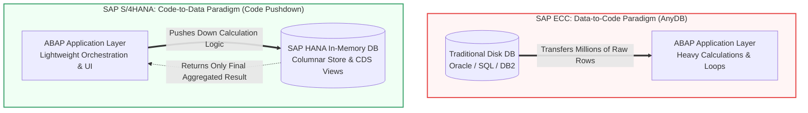

[🔼 العودة لخريطة الدليل](#-خريطة-الدليل-السريعة)

---

## ⏳ 2. التطور التاريخي والمعماري لأنظمة SAP — من R/1 إلى S/4HANA

تأسست شركة `SAP` في ألمانيا عام **1972** على يد خمسة مهندسين سابقين في شركة `IBM` تحت اسم `Systemanalyse und Programmentwicklung`، ثم أصبحت لاحقاً اختصاراً لـ `Systeme, Anwendungen und Produkte in der Datenverarbeitung` أي النظم والتطبيقات والمنتجات في معالجة البيانات.

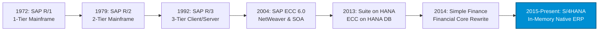

| الجيل والإصدار | سنة الإطلاق | المعمارية التقنية | الخصائص الهندسية والوظيفية الجوهرية |
| :--- | :--- | :--- | :--- |
| **`SAP R/1`** الجيل الأول | `1972` | **`1-Tier Architecture`** خادم مركزي `Mainframe` | يرمز حرف `R` إلى المعالجة الفورية `Real-Time Processing`. كانت طبقة العرض، ومنطق التطبيق، وقاعدة البيانات تعمل جميعها في طبقة واحدة على أجهزة `IBM Mainframe`. |
| **`SAP R/2`** الجيل الثاني | `1979` | **`2-Tier Architecture`** خادم مركزي `Mainframe` | فصل جزئي بين الطبقات، وصُمم لدعم الشركات الأوروبية الكبرى متعددة الجنسيات، اللغات، والعملات، مع شاشات نصية أحادية اللون. |
| **`SAP R/3`** الجيل الثالث | `1992` | **`3-Tier Architecture`** معمارية `Client / Server` | نقلة تاريخية فصلت النظام إلى 3 طبقات مستقلة: 1. طبقة العرض `Presentation Layer — SAP GUI` 2. طبقة التطبيقات `Application Layer — ABAP` 3. طبقة قاعدة البيانات `Database Layer — Any RDBMS` |
| **`SAP ERP ECC`** المكون المركزي | `2004` | **`3-Tier + SAP NetWeaver`** أشهرها إصدار `ECC 6.0` | اختصار `ERP Central Component`، وصدر له ثماني حزم تحديث `EhP 1` حتى `EhP 8`، وقدم البنية الخدمية `SOA` والـ `New GL` في المالية. |
| **`Suite on HANA`** المرحلة الانتقالية | `2013` | **`ECC 6.0 on HANA DB`** يُعرف اختصاراً بـ `SoH` | تشغيل كود وجداول نظام `ECC` القديم كما هي على قاعدة بيانات `SAP HANA` التي أُطلقت عام 2010، مما سرّع التقارير دون تغيير هيكل الجداول. |
| **`SAP S/4HANA`** الجيل الرابع | `2015` | **`In-Memory Native ERP`** `Fiori + ABAP + HANA` | بدأ بإطلاق `Simple Finance` عام 2014 ثم `S/4HANA` الكامل في فبراير 2015؛ إعادة كتابة شاملة للكود، إلغاء جداول الإجماليات، ودمج `OLTP + OLAP`. |

[🔼 العودة لخريطة الدليل](#-خريطة-الدليل-السريعة)

---

## 💡 3. لماذا يجب على المستشار فهم تاريخ النسخ السابقة SAP ECC؟

حتى لو كنت تبدأ مسيرتك المهنية اليوم على أحدث إصدار من `S/4HANA`، فإن فهم معمارية `SAP ECC` وكيف تحولت يُعد ضرورة استراتيجية لثلاثة أسباب عملية:

* **1. قيادة مشاريع التحول قبل انتهاء الدعم الرسمي في 2027 / 2030:**
  حددت شركة ساب عام **2027** موعداً لانتهاء الصيانة القياسية `Mainstream Maintenance` لنظام `SAP ECC 6.0`، وعام **2030** لانتهاء الصيانة الممتدة الاختيارية `Extended Maintenance`. لذلك فإن نسبة ضخمة من مشاريع السوق الحالية هي مشاريع تحويل أنظمة قائمة `System Conversions` تتطلب مستشاراً يفهم الهيكليتين.
* **2. كسب ثقة المديرين الماليين والمستخدمين القدامى `CFOs & Key Users`:**
  المدير المالي أو المحاسب الرئيسي الذي عمل لمدة 10 أو 15 عاماً على `ECC` سيتحدث معك بلغة النظام القديم؛ سيسألك مثلاً: *"أين ذهبت شاشات العملاء والموردين `FD01` و `FK01`؟"* أو *"كيف أربط الحساب بعنصر تكلفة بدون شاشة `KA01`؟"* أو *"كيف تتطابق المالية مع التكاليف بدون تسوية؟"*. قدرتك على شرح السبب المعماري تمنحك مصداقية فورية.
* **3. التفوق في مقابلات العمل التقنية والوظيفية `Consultant Interviews`:**
  السؤال الكلاسيكي الأول في أي مقابلة عمل لمستشار ساب هو: **"ما هي أبرز الفروقات في موديولك بين ECC و S/4HANA؟"**، وهي العناصر الموثقة رسمياً من ساب تحت مسمى **`Simplification List`**.

[🔼 العودة لخريطة الدليل](#-خريطة-الدليل-السريعة)

---

## 🔄 4. التحول الجذري في هيكل البيانات والعمليات — مقارنة هندسية ECC vs. S/4HANA

### أولاً: من فصل المعاملات والتحليلات إلى دمجها `OLTP + OLAP Convergence`

في نظام `ECC` القديم، كانت قراءة ملايين البنود لحساب رصيد حساب عام أو عميل عملية بطيئة جداً على الأقراص الصلبة، فاضطر النظام للاحتفاظ ببيانات مكررة في:
* **جداول الإجماليات المسبقة — `Totals Tables`:** مثل جدولي `GLT0` و `FAGLFLEXT` للمالية، وجدولي `COSP` و `COSS` للتكاليف.
* **جداول المؤشرات الثانوية — `Secondary Index Tables`:** مثل `BSIS / BSAS` للحسابات العامة، و `BSID / BSAD` للعملاء، و `BSIK / BSAK` للموردين لفصل البنود المفتوحة `Open Items` عن المسددة `Cleared Items`.

في `S/4HANA`، تم **حذف كافة جداول الإجماليات والمؤشرات الثانوية فعلياً من قاعدة البيانات**، واستُبدلت بواجهات عرض توافقية `Compatibility Views` تحمل نفس الأسماء القديمة لضمان عدم تعطل تقارير `ABAP` المخصصة القديمة، بينما تُقرأ وتُجمع كافة البيانات لحظياً `On-the-fly Aggregation` من جدول مركزي واحد.

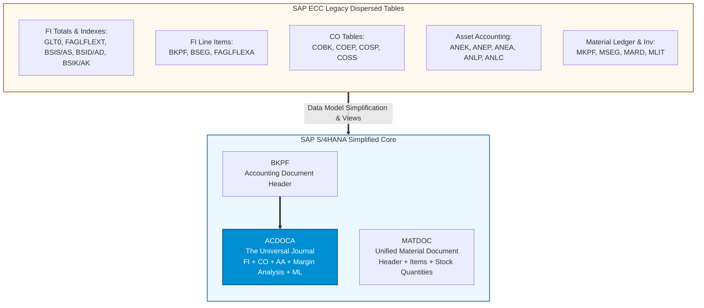

### ثانياً: جدول المقارنة الهندسي الشامل للفروقات الوظيفية `Core Modules Delta`

| المحور والموديول | الوضع القديم في `SAP ECC` | الوضع الحديث في `SAP S/4HANA` | الأثر الاستشاري المباشر `Consultant Impact` |
| :--- | :--- | :--- | :--- |
| **قيود المالية والتكاليف** `FI & CO Journals` | جداول منفصلة للمالية `BSEG / FAGLFLEXA` والتكاليف `COEP`، مما يسبب فجوات تتطلب تسوية نهاية الشهر. | **`ACDOCA` — `Universal Journal`** دمج كامل في جدول واحد لجميع بنود المالية والتكاليف والأصول والربحية. | تطابق لحظي بنسبة 100% بين `FI` و `CO` بالثانية الواحدة وإلغاء قيود التسوية الدورية. |
| **عناصر التكلفة** `Cost Elements` | تُنشأ في شاشات منفصلة عن شجرة الحسابات عبر كود `KA01` للأولية وكود `KA06` للثانوية. | **مدمجة داخل شاشة `FS00`** أصبحت جزءاً من بيانات الحساب العام `G/L Master Data` عبر حقل `Account Type`. | توحيد شجرة الحسابات مع عناصر التكاليف الأولية والثانوية وإلغاء شاشات `KA01 / KA02 / KA06`. |
| **العملاء والموردون** `Customer & Vendor` | شاشات وجداول منفصلة تماماً للعملاء `FD01 / VD01 / XD01` وللموردين `FK01 / MK01 / XK01`. | **إلزامية شريك الأعمال `BP`** دمج كامل في شاشة `Business Partner` عبر آلية المزامنة `CVI`. | سجل رئيسي واحد للشريك يقبل أدواراً متعددة مثل دور عميل `FLCU00/01` ودور مورد `FLVN00/01`. |
| **محاسبة الأصول الثابتة** `New Asset Accounting` | جداول متعددة `ANEK, ANEP, ANLC` وترحيل غير متزامن لمناطق الإهلاك الثانوية. | **دمج كامل في `ACDOCA`** تفعيل إلزامي لـ `New FI-AA` وترحيل لحظي لكل معيار محاسبي `Accounting Principle` بشكل منفصل. | استخدام حساب تسوية فني `Technical Clearing Account` عند شراء الأصل لضمان توازن كل معيار محاسبي لحظياً. |
| **حركات المخزون والمواد** `MM Inventory` | تشتت الحركات والأرصدة في جداول `MKPF` و `MSEG` و `MARD` و `MBEW` مع حدوث إغلاق للجداول أثناء الترحيل. | **جدول المخزون الموحد `MATDOC`** دمج الرأس والتفاصيل في جدول واحد وحساب الكميات لحظياً بنظام `INSERT Only`. | سرعة فائقة في ترحيل حركات المخازن بدون `Table Locks` وتقارير مخزون فورية. |
| **دفتر أستاذ المواد** `Material Ledger` | اختياري `Optional` ويُفعل فقط للشركات التي تطبق تعدد العملات في المخزون أو التكلفة الفعلية. | **تفعيل إجباري `Mandatory`** إلزامي لتقييم المخزون وتعدد العملات، بينما يبقى `Actual Costing` اختيارياً. | خطوة كونفيجريشن إلزامية عبر أكواد `OMX1 / OMX2 / OMX3` عند تشغيل أي مصنع `Plant` جديد. |
| **تحليل الربحية** `CO-PA Module` | الاعتماد الشائع على `Costing-Based CO-PA` الذي يخزن القيم في جداول منفصلة عن الأستاذ العام. | **تحليل الهامش `Margin Analysis`** الاعتماد الأساسي على `Account-Based CO-PA` المدمج مباشرة كأعمدة داخل `ACDOCA`. | ظهور كافة خصائص الربحية `Characteristics` مباشرة على سطر القيد المالي دون أي فروق مع ميزان المراجعة. |
| **إدارة الائتمان** `Credit Management` | إدارة الائتمان البسيطة التابعة للعملاء `FI-AR-CR` عبر شاشات `FD32` و `VKM1`. | **نظام `FIN-FSCM-CR` المتقدم** انتقال إجباري إلى `SAP Credit Management` ضمن سلسلة التوريد المالية. | إدارة الحدود الائتمانية والتقييم الآلي للمخاطر عبر دور `UKM000` داخل شاشة شريك الأعمال `BP`. |
| **إدارة الحسابات البنكية** `Bank Account Mgmt` | تعريف حسابات البنوك كبيانات إعداد ثابتة `Configuration` عبر شاشة `FI12`. | **بيانات أساسية `BAM Lite / Cash Mgmt`** تحولت الحسابات البنكية إلى `Master Data` تُدار عبر تطبيقات `Fiori` مع الاحتفاظ بـ `FI12_HBANK` للبنك الرئيسي. | مرونة للمدير المالي في فتح وتعديل الحسابات البنكية وتحديد صلاحيات التوقيع مباشرة من شاشات فيوري. |

[🔼 العودة لخريطة الدليل](#-خريطة-الدليل-السريعة)

---

## 🏗️ 5. تعمق استشاري: تشريح جدول اليومية الموحد ACDOCA وشريك الأعمال BP

### أولاً: التشريح الهندسي لجدول اليومية الموحد `Universal Journal — ACDOCA`

يمثل جدول `ACDOCA` القلب النابض لموديول المالية والتكاليف في `S/4HANA`، ويمتلك أربع قدرات هندسية يجب على كل مستشار `FICO` إتقانها:

1. **كسر حاجز الـ 999 سطراً في القيد المالي:**
   في جدول `BSEG` القديم، كان حقل رقم السطر يتكون من 3 خانات فقط `3-digit field`، مما جعل الحد الأقصى لأي قيد مالي هو `999` سطراً فقط. في جدول `ACDOCA`، أصبح حقل رقم السطر يتكون من 6 خانات `DOCLN` مما يسمح بتسجيل حتى **`999,999` سطراً في القيد المحاسبي الواحد**!
2. **دعم حتى 10 عملات متوازية في السطر الواحد `Parallel Currencies`:**
   بينما كان نظام `ECC` يدعم 3 عملات كحد أقصى في `FI` وعملتين في `CO`، يوفر جدول `ACDOCA` في إعدادات شاشة **`FINSC_LEDGER`** إمكانية تفعيل حتى **10 عملات متوازية** لكل دفتر أستاذ:
   * **العملة الأولى الثابتة:** عملة الشركة المحلية `Company Code Currency — Type 10`.
   * **العملة الثانية الثابتة:** العملة العالمية أو عملة المجموعة المتكاملة مع التكاليف `Global / Controlling Area Currency — Type 30`.
   * **8 عملات إضافية حرة:** يمكن للمستشار تخصيصها بحرية `Freely Defined Currencies` لأغراض التقارير الضريبية أو الإقليمية.
3. **دفاتر الأستاذ الامتدادية `Extension Ledgers`:**
   ميزة معمارية تسمح بإنشاء دفتر أستاذ فرعي يرث كافة قيود دفتر الأستاذ الأساسي `Underlying Standard Ledger — 0L` دون تكرار تخزينها في قاعدة البيانات، ويُستخدم لتسجيل قيود التسويات الإدارية أو المحاكاة أو الفروق الضريبية الخاصة فقط.
4. **أنواع الحسابات الأربعة في شاشة `FS00` بعد دمج عناصر التكلفة:**
   * **`X — Balance Sheet Account`:** حسابات الميزانية العمومية.
   * **`N — Non-Operating Expense or Income`:** مصروفات أو إيرادات غير تشغيلية لا تتطلب التوجيه لتكاليف `CO`.
   * **`P — Primary Costs or Revenue`:** مصروفات أو إيرادات تشغيلية تعمل كعنصر تكلفة أولي `Primary Cost Element` وتتطلب كائن تكلفة مثل مركز تكلفة `Cost Center` أو أمر داخلي `Internal Order`.
   * **`S — Secondary Costs`:** حسابات تُستخدم حصرياً لتوزيعات وتسويات التكاليف الداخلية `Assessments, Distributions & Activity Allocations` كعناصر تكلفة ثانوية `Secondary Cost Elements`.

### ثانياً: معمارية شريك الأعمال الموحد `Business Partner — BP` وآلية `CVI`

ألغت ساب شاشات العملاء والموردين التقليدية واستبدلتها بكود موحد هو **`BP`**، وتُدار عملية الربط في الخلفية عبر محرك **`CVI — Customer Vendor Integration`** الذي يضمن تحديث جداول `BUT000` الخاصة بشريك الأعمال بالتزامن مع جداول `KNA1 / LFA1` المرتبطة بالعمليات.

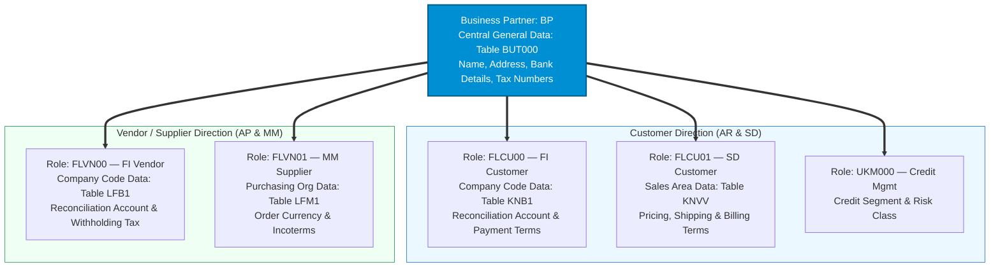

[🔼 العودة لخريطة الدليل](#-خريطة-الدليل-السريعة)

---

## 🔗 6. تعمق تطبيقي: التكامل اللحظي للدورات المستندية الكبرى في S/4HANA

قوة نظام `SAP S/4HANA` تكمن في أن الموظف في المخازن أو المبيعات يؤدي حركته اللوجستية، فيقوم النظام في نفس اللحظة بتوليد القيد المالي والتكاليفي وتحديث الربحية داخل جدول `ACDOCA` تلقائياً:

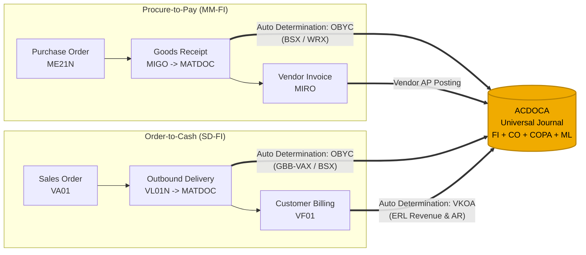

| الدورة المستندية | مسار الحركة اللوجستية | نقطة الربط التلقائي `Integration T-Code` | أثر القيد المحاسبي اللحظي في جدول `ACDOCA` |
| :--- | :--- | :--- | :--- |
| **من الشراء إلى الدفع** `Procure-to-Pay — P2P` | 1. أمر شراء `ME21N` 2. استلام مخزني `MIGO` 3. فاتورة مورد `MIRO` 4. سداد `F110` | **شاشة `OBYC` — ربط `MM-FI`** مفاتيح الترحيل التلقائي مثل `BSX` للمخزون و `WRX` لوسيط الاستلام والفوترة `GR/IR`. | عند حفظ استلام البضاعة في `MIGO`، يُسجل المستند المخزني في `MATDOC` ويُولد قيد مالي لحظي في `ACDOCA` يجعل المخزون مديناً وحساب وسيط `GR/IR` دائناً. |
| **من الطلب إلى التحصيل** `Order-to-Cash — O2C` | 1. أمر بيع `VA01` 2. صرف بضاعة `VL01N` 3. فاتورة مبيعات `VF01` 4. تحصيل `F-28` | **شاشة `OBYC` لتكلفة المبيعات** **وشاشة `VKOA` — ربط `SD-FI`** مفتاح `ERL` للإيرادات ومفتاح `ERS` للخصومات. | عند صرف البضاعة يُرحل قيد تكلفة البضاعة المباعة `COGS`، وعند إصدار الفاتورة يُرحل قيد العميل والإيراد مع تغذية خصائص ربحية `Margin Analysis` في نفس السطر داخل `ACDOCA`. |
| **من التسجيل إلى التقرير** `Record-to-Report — R2R` | 1. قيود اليومية `FB50` 2. دورة الإهلاك `AFAB` 3. تقييم العملات `FAGL_FCV` 4. القوائم المالية | **تطبيقات الإقفال المالي** وتحديد الحسابات التلقائية لفروق العملة في شاشة `OBA1`. | تُرحل كافة التسويات، إهلاكات الأصول، وفروق تقييم العملات الأجنبية مباشرة في `ACDOCA` لتظهر القوائم المالية اللحظية عبر تطبيقات `Fiori Analytical Apps`. |

[🔼 العودة لخريطة الدليل](#-خريطة-الدليل-السريعة)

---

## ☁️ 7. مقارنة شاملة لبيئات التشغيل: On-Premise vs. Private Cloud vs. Public Cloud

> **⚠️ قاعدة استشارية فاصلة:**
> الاختلاف بين بيئات التشغيل الثلاث **ليس مجرد مكان وجود السيرفر!** بل يغير جذرياً أداة الكونفيجريشن التي يستخدمها المستشار، صلاحية كتابة الكود البرمجي، مرونة تعديل الدورة المستندية، وسياسة التحديثات الإجبارية.

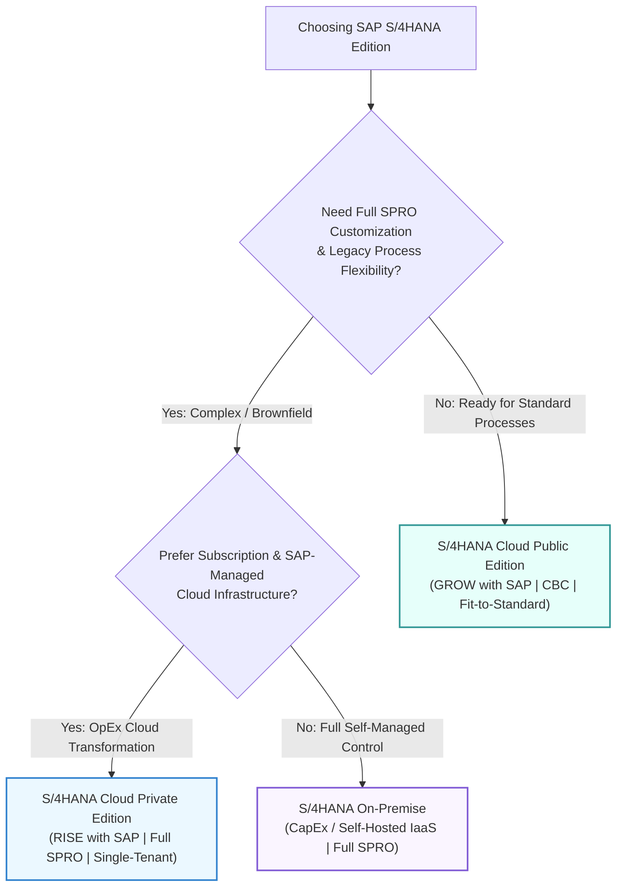

| معيار المقارنة | `S/4HANA On-Premise` | `S/4HANA Cloud Private Edition` | `S/4HANA Cloud Public Edition` |
| :--- | :--- | :--- | :--- |
| **نموذج الحوسبة والاستضافة** `Hosting & Architecture` | **محلي أو سحابة ذاتية `IaaS`** سيرفرات تمتلكها أو تستأجرها الشركة وتديرها بالكامل. | **سحابة خاصة `Single-Tenant`** بيئة سحابية معزولة لشركة واحدة فقط تدير بنيتها شركة ساب. | **سحابة عامة `Multi-Tenant SaaS`** بيئة سحابية تشاركية يعمل فيها جميع العملاء على نفس النواة القياسية. |
| **أداة الكونفيجريشن للمستشار** `Configuration Tool` | **شاشة `SPRO / IMG` الكاملة** تحكم كامل في كافة مسارات الإعدادات التقليدية عبر `SAP GUI`. | **شاشة `SPRO / IMG` الكاملة** مطابقة تماماً لنسخة `On-Premise` بنسبة 100%. | **منصة `SAP CBC` وشاشات `SSCUIs`** **لا يوجد `SPRO`!** يتم الإعداد عبر `Central Business Configuration` وواجهات الخدمة الذاتية. |
| **مرونة العمليات المستندية** `Business Processes` | **مرونة مطلقة** إمكانية تفصيل وتطويع العمليات لتناسب أعقد متطلبات الشركة. | **مرونة مطلقة** نفس قدرات التخصيص الكاملة المتاحة في `On-Premise` مع دعم كافة الصناعات. | **التزام قياسي `Fit-to-Standard`** تلتزم الشركة بتطبيق العمليات القياسية الجاهزة `Scope Items` مع هامش تخصيص محدد. |
| **واجهة المستخدم المعتمدة** `User Interface` | **واجهات `SAP Fiori` + `SAP GUI`** كلاهما متاح للمستخدمين والمستشارين. | **واجهات `SAP Fiori` + `SAP GUI`** كلاهما متاح للمستخدمين والمستشارين. | **واجهات `SAP Fiori` فقط عبر المتصفح** لا يُسمح للمستخدمين أو المستشارين بالعمل عبر `SAP GUI` التقليدي. |
| **البرمجة والتعديلات** `Extensibility & ABAP` | **صلاحية كاملة** مسموح بـ `Classic ABAP` عبر `SE38 / SE80` وحتى التعديل على الكود الأصلي رغم عدم التوصية به. | **صلاحية كاملة مع توجيه `Clean Core`** وصول كامل لطبقة `ABAP` مع التوصية القوية بعزل التعديلات عبر `ABAP Cloud` و `BTP`. | **ممنوع `Classic ABAP` التقليدي!** التوسع يتم حصرياً عبر `In-App Extensibility` و `ABAP Cloud` ومنصة `SAP BTP`. |
| **سياسة التحديثات والترقية** `Upgrades & Releases` | **اختيارية بالكامل** إصدار رئيسي كل سنتين، والشركة تقرر متى تقوم بالترقية. | **مرنة بالتنسيق مع ساب** نفس إصدارات `On-Premise`، والشركة تختار توقيت الترقية بشرط البقاء في إصدار مدعوم. | **إجبارية وتلقائية من ساب!** تحديثان رئيسيان سنوياً في فبراير وأغسطس يطبقان على جميع العملاء في وقت واحد. |
| **نموذج الترخيص والإدارة** `Commercial & Basis Ops` | شراء ترخيص رأسمالي `CapEx`، والشركة تتحمل إدارة السيرفرات وقواعد البيانات وفريق `Basis`. | اشتراك سنوي `OpEx` ضمن حزمة **`RISE with SAP`**؛ تتولى ساب إدارة البنية التحتية والـ `Technical Basis`. | اشتراك سنوي شامل `SaaS OpEx` ضمن حزمة **`GROW with SAP`**؛ تدير ساب النظام بالكامل 100%. |

[🔼 العودة لخريطة الدليل](#-خريطة-الدليل-السريعة)

---

## 📦 8. الحزم الاستراتيجية: الفرق التعاقدي والتقني بين RISE with SAP و GROW with SAP

كثيراً ما يحدث خلط في السوق بين **المنتج التقني** `S/4HANA` وبين **الباقة التجارية والاستراتيجية** `RISE / GROW`:

| وجه المقارنة | حزمة `RISE with SAP` | حزمة `GROW with SAP` |
| :--- | :--- | :--- |
| **المفهوم الأساسي** | خدمة التحول المؤسسي الشامل `Business Transformation as a Service` للشركات الكبرى والمعقدة. | باقة التبني السحابي السريع للشركات المتوسطة والناشئة سريعة النمو `Midmarket & Scale-ups`. |
| **النسخة التقنية الأساسية** | تعتمد بشكل رئيسي على **`S/4HANA Cloud Private Edition`**. | تعتمد حصرياً على **`S/4HANA Cloud Public Edition`**. |
| **مسارات التنفيذ المدعومة** | تدعم جميع المسارات: `Greenfield` و `Brownfield` و `Bluefield`. | تدعم مسار التنفيذ الجديد **`Greenfield` فقط** بأفضل الممارسات الجاهزة. |
| **الأدوات والمنصات المدمجة في العقد** | 1. استضافة مُدارة على عمالقة السحابة `Hyperscalers: AWS, Azure, Google Cloud` 2. منصة **`SAP Signavio`** لتحليل وتعدين العمليات 3. منصة **`SAP LeanIX`** لإدارة معمارية الأنظمة المؤسسية 4. رصيد سحابي في منصة التطوير **`SAP BTP`** ومساعد الذكاء الاصطناعي **`SAP Joule`** | 1. تفعيل فوري للعمليات القياسية عبر **`SAP CBC`** 2. خدمات تنفيذ سريعة بنطاق زمني ومالي محدد 3. وصول لمنصة **`SAP BTP`** ومجتمع التعلم 4. مساعد الذكاء الاصطناعي المدمج **`SAP Joule`** والتحديثات التلقائية |

[🔼 العودة لخريطة الدليل](#-خريطة-الدليل-السريعة)

---

## 🛤️ 9. مسارات الانتقال والتحول: Greenfield vs. Brownfield vs. Bluefield

عندما تقرر مؤسسة الانتقال إلى `SAP S/4HANA`، هناك **ثلاثة مسارات هندسية معتمدة** يجب على كل مستشار التمييز الدقيق بينها وبين أدواتها التقنية:

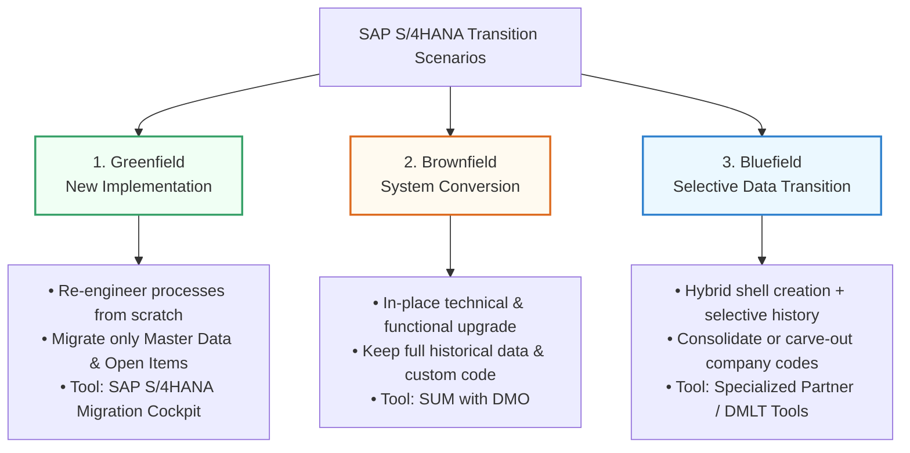

| معيار المقارنة | `1. Greenfield` — تنفيذ جديد | `2. Brownfield` — تحويل النظام | `3. Bluefield` — انتقال انتقائي |
| :--- | :--- | :--- | :--- |
| **الفكرة الهندسية** | بناء نظام `S/4HANA` جديد تماماً من الصفر، وإعادة تصميم العمليات وفقاً لأفضل الممارسات القياسية `Best Practices`. | ترقية النظام الحالي `SAP ECC` في مكانه ليتحول تقنياً ووظيفياً إلى `S/4HANA` دون إعادة بناء من الصفر. | مسار هجين يبني بيئة جديدة نظيفة مع نقل انتقائي لبيانات تاريخية محددة، أو دمج وفصل عدة أنظمة `ECC`. |
| **مصير البيانات التاريخية** | يُنقل فقط **البيانات الأساسية `Master Data` والأرصدة الافتتاحية والبنود المفتوحة `Open Items`**. | يتم **الاحتفاظ بكافة البيانات التاريخية للسنوات السابقة بالكامل** وتحويلها تلقائياً إلى جدول `ACDOCA`. | اختيار انتقائي؛ مثل نقل حركات آخر سنتين فقط أو نقل بيانات شركات محددة `Company Codes` دون غيرها. |
| **الأداة التقنية المستخدمة** | **`SAP S/4HANA Migration Cockpit`** تطبيق فيوري `Migrate Your Data` — كود `LTMC` سابقاً — بطريقتيه: 1. `Staging Tables` عبر ملفات أو جداول وسيطة 2. `Direct Transfer` من نظام ساب قديم | **`SUM with DMO`** أداة `Software Update Manager` مع خيار `Database Migration Option` لترقية الكود وتحويل قاعدة البيانات إلى `HANA` في خطوة واحدة. | أدوات متخصصة من قسم `SAP DMLT` أو شركاء معتمدين مثل `SNP CrystalBridge` و `CBS`. |
| **النسخ المتاحة كهدف** | متاح للانتقال إلى `On-Premise` أو `Private Cloud` أو `Public Cloud`. | متاح **فقط** للانتقال إلى `On-Premise` أو `Private Cloud` — لا يمكن تحويل `ECC` تقنياً إلى `Public Cloud`. | متاح للانتقال إلى `On-Premise` أو `Private Cloud`. |

[🔼 العودة لخريطة الدليل](#-خريطة-الدليل-السريعة)

---

## 📋 10. منهجية التنفيذ القياسية SAP Activate وهيكل بيئات النظام Landscape

### أولاً: المراحل الست لمنهجية `SAP Activate` ومخرجات المستشار

استبدلت شركة ساب منهجيتها القديمة `ASAP Methodology` التي كانت تُستخدم في أيام `ECC` بمنهجية حديثة رشيقة هي **`SAP Activate`**، وتتكون من 6 مراحل متتالية:

| المرحلة | الهدف الرئيسي للمرحلة | أهم مهام ومخرجات المستشار `Consultant Deliverables` |
| :--- | :--- | :--- |
| **`1. Discover`** الاكتشاف | تقييم جدوى التحول، تجربة النظام التجريبي، واختيار النسخة ومسار الانتقال المناسب. | تقديم عرض توضيحي للنظام القياسي، المساعدة في فحص الجاهزية `Readiness Check`، وتحديد خارطة الطريق. |
| **`2. Prepare`** التحضير | تأسيس حوكمة المشروع، تشكيل فرق العمل، وتجهيز البيئة المبدئية بأفضل الممارسات. | تجهيز قائمة العمليات المستهدفة `Scope Items`، خطة المشروع، وتفعيل نظام `Sandbox / Starter System`. |
| **`3. Explore`** الاستكشاف | **أهم مرحلة للمستشار الوظيفي:** استعراض العمليات القياسية أمام العميل وتحديد الفجوات. | قيادة ورش عمل **`Fit-to-Standard Workshops`**، توثيق قائمة الفجوات والتعديلات في **`Backlog / Delta Design`**، واعتماد قائمة العمليات النهائية `BPML`. |
| **`4. Realize`** الإنجاز والبناء | تنفيذ الكونفيجريشن، تطوير البرامج الإضافية والتقارير، وإجراء الاختبارات المتكاملة. | تنفيذ الإعدادات في `SPRO / CBC`، كتابة المواصفات الوظيفية `Functional Specs — WRICEF` للمبرمجين، وإجراء اختبارات الوحدة `FUT` والتكامل `SIT` وقبول المستخدم `UAT`. |
| **`5. Deploy`** الإطلاق الحي | تدريب المستخدمين النهائيين، نقل الأرصدة الافتتاحية، والتحول للتشغيل الفعلي `Go-Live`. | تنفيذ خطة القطع والانتقال **`Cutover Plan`**، سحب البيانات الأساسية والأرصدة عبر `Migration Cockpit`، ومطابقة موازين المراجعة قبل بدء العمل الحي. |
| **`6. Run`** التشغيل والدعم | دعم ما بعد الإطلاق `Hypercare`، استقرار النظام، ومتابعة التحديثات الدورية. | حل المشاكل اليومية للمستخدمين، إقفال أول شهر مالي مع العميل، وتطبيق التحسينات المستمرة. |

### ثانياً: معمارية بيئات العمل `3-Tier System Landscape` وطلبات النقل `Transport Requests`

لا يقوم مستشار ساب أبداً بإجراء أي كونفيجريشن أو تعديل مباشر على البيئة الحية `Production`، بل يمر العمل عبر ثلاث بيئات متتالية باستخدام نظام إدارة النقل `TMS — Transaction STMS / SE09`:

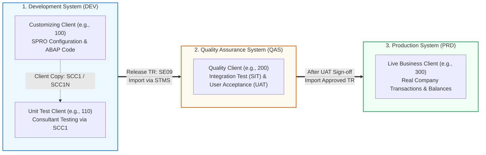

* **النوع الأول من طلبات النقل — `Customizing Request`:**
  يتولد تلقائياً عندما يقوم المستشار الوظيفي بضبط إعدادات داخل شاشة `SPRO`؛ ويكون مرتبطاً بـ `Client` محدد `Client-Specific`.
* **النوع الثاني من طلبات النقل — `Workbench Request`:**
  يتولد عند إنشاء أو تعديل كود برمجي `ABAP`، أو إنشاء جدول، أو تعديل إعدادات عابرة للـ Clients مثل بعض هياكل النظام `Cross-Client Objects`.

[🔼 العودة لخريطة الدليل](#-خريطة-الدليل-السريعة)

---

## 📱 11. معمارية واجهات المستخدم الحديثة SAP Fiori & Launchpad

استبدلت ساب الشاشات الرمادية التقليدية المعقدة بنظام **`SAP Fiori`** الذي يعتمد على 5 مبادئ تصميمية: مبني على الدور الوظيفي `Role-Based`، متجاوب مع كافة الشاشات `Responsive`، بسيط `Simple`، مترابط `Coherent`، ومبهج الاستخدام `Delightful`.

### أولاً: الأنواع الثلاثة لتطبيقات `SAP Fiori`

1. **التطبيقات التشغيلية — `Transactional Apps`:**
   تُستخدم لتنفيذ المهام والمعاملات اليومية مثل إنشاء قيد يومية `Post General Journal Entries` أو إنشاء أمر شراء أو اعتماد إجازة.
2. **التطبيقات التحليلية — `Analytical Apps`:**
   تستغل قوة قاعدة بيانات `HANA` وواجهات `CDS Views` لعرض مؤشرات الأداء اللحظية `KPIs` والرسوم البيانية التفاعلية مثل تحليل أعمار الديون أو السيولة النقدية.
3. **تطبيقات صفحات الحقائق — `Fact Sheets / Object Pages`:**
   تعمل مع محرك البحث الفوري داخل `Fiori Launchpad` لعرض ملخص شامل بزاوية 360 درجة لأي كائن في النظام مثل بطاقة عميل أو مستند محاسبي مع إمكانية التتبع والانتقال للمستندات المرتبطة.

### ثانياً: كيف يربط المستشار تطبيقات Fiori بصلاحيات المستخدم؟

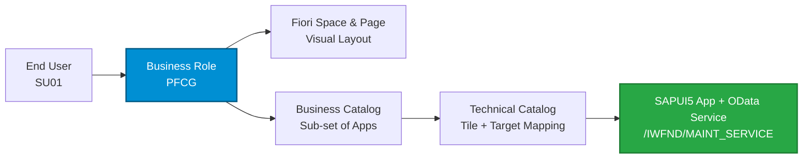

* **الكتالوج الفني وكتالوج الأعمال — `Technical & Business Catalogs`:** يحتوي الكتالوج على المربع البصري `Tile` ورابط التوجيه الفعلي للتطبيق `Target Mapping`.
* **المساحات والصفحات — `Spaces & Pages`:** النظام الحديث الذي حل محل المجموعات القديمة `Fiori Groups` لتنظيم شكل وترتيب التطبيقات على شاشة المستخدم.
* **دور الأعمال — `Business Role in PFCG`:** يجمع الكتالوجات والمساحات معاً ويُمنح للمستخدم ليرى فقط التطبيقات الخاصة بوظيفته مثل دور محاسب المدفوعات `SAP_BR_AP_ACCOUNTANT`.

[🔼 العودة لخريطة الدليل](#-خريطة-الدليل-السريعة)

---

## 🧹 12. فهم فلسفة Clean Core ونموذج التوسع الحديث 3-Tier Extensibility

تُعد قاعدة **الحفاظ على نظافة النواة — `Keep the Core Clean`** المبدأ الهندسي الأهم في مشاريع `S/4HANA` الحديثة لضمان سهولة وسرعة ترقية النظام دون تعطل الأكواد المخصصة كما كان يحدث في عصر `ECC`.

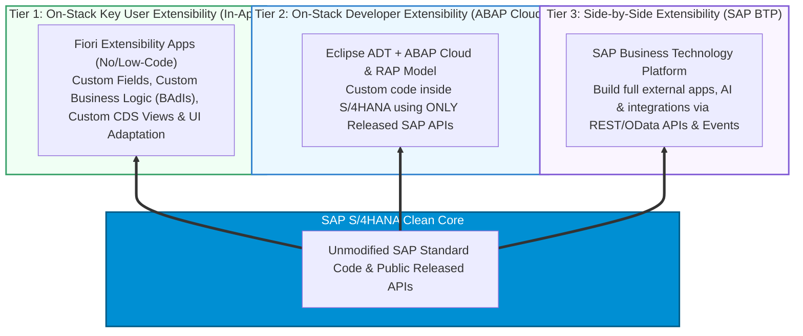

| طبقة التوسع | المسمى التقني والأدوات | متى نلجأ إليها ومن ينفذها؟ |
| :--- | :--- | :--- |
| **الطبقة الأولى** `Tier 1 — Key User` | **`On-Stack Key User Extensibility`** تطبيقات فيوري المدمجة مثل `Custom Fields and Logic` و `Adapt UI`. | تعديلات خفيفة ينفذها المستشار الوظيفي مباشرة من المتصفح لإضافة حقل جديد في جدول `ACDOCA` أو شاشة، أو تعديل نموذج طباعة، أو بناء تقرير `CDS View` بسيط. |
| **الطبقة الثانية** `Tier 2 — Developer` | **`On-Stack Developer Extensibility`** البرمجة عبر بيئة `Eclipse ADT` باستخدام نموذج **`ABAP Cloud & RAP`**. | عندما نحتاج لمنطق برمجي معقد مرتبط ببيانات `S/4HANA` مباشرة، حيث يكتب المبرمج الكود داخل النظام ولكن يُسمح له فقط باستدعاء الواجهات المعتمدة من ساب `Released APIs`. |
| **الطبقة الثالثة** `Tier 3 — Side-by-Side` | **`Side-by-Side Extensibility`** التطوير الخارجي على منصة **`SAP BTP`**. | لبناء تطبيقات مستقلة بالكامل، أو بوابات للموردين والعملاء، أو ربط أنظمة خارجية غير ساب بحيث تبقى النواة نظيفة تماماً وتتواصل عبر `OData / REST APIs`. |

[🔼 العودة لخريطة الدليل](#-خريطة-الدليل-السريعة)

---

## 📅 13. دليل قراءة إصدارات SAP ونشرات التحديث Release Strategy & What's New

### أولاً: كيف تقرأ أرقام إصدارات `SAP S/4HANA` بدقة؟

1. **النظام القديم للتسمية من 2015 حتى 2019 — صيغة السنة والشهر `YYMM`:**
   * إصدار **`1511`:** صدر في نوفمبر 2015.
   * إصدار **`1610`:** صدر في أكتوبر 2016.
   * إصدارات **`1709`** ثم **`1809`** ثم **`1909`:** صدرت في شهر سبتمبر من أعوام 2017 و 2018 و 2019.
2. **النظام الحديث لنسخ `On-Premise & Private Cloud` من 2020 فصاعداً — صيغة السنة `YYYY`:**
   * أصبحت تُسمى بالسنة الميلادية مباشرة: **`2020`** ثم **`2021`** ثم **`2022`** ثم **`2023`** ثم **`2025`**.
   * **تغيير استراتيجي هام:** بدءاً من إصدار **`SAP S/4HANA 2023`**، حولت ساب دورة إطلاق الإصدارات الرئيسية من سنوية إلى **كل عامين `Every 2 Years`**، ومددت فترة الصيانة القياسية لكل إصدار من 5 سنوات إلى **7 سنوات كاملة**.
3. **تسمية إصدارات `Public Cloud` — صيغة السنة والشهر `YYMM`:**
   * تصدر مرتين سنوياً في فبراير وأغسطس مثل: **`2402`**، **`2408`**، **`2502`**، **`2508`**، **`2602`**، **`2608`**.

### ثانياً: الفرق الهندسي بين حزم `FPS` وحزم `SPS`

عندما تقرأ عنوان وثيقة رسمية مثل `What's New in SAP S/4HANA 1809 SPS09` أو `SAP S/4HANA 2023 FPS02`، فهذا هو التسلسل الزمني والفرق بينهما:

```mermaid
flowchart LR
    R0["Major Release<br>FPS00 (Initial Shipment)"] --> F1["FPS01<br>New Features + Fixes"]
    F1 --> F2["FPS02<br>New Features + Fixes"]
    F2 --> F3["FPS03<br>New Features + Fixes"]
    F3 --> S4["SPS04<br>Bug Fixes & Security Only"]
    S4 --> S5["SPS05 ... SPS09+<br>Continuous Maintenance"]

    style R0 fill:#008FD3,color:#fff,stroke:#005b87,stroke-width:2px
    style F1 fill:#e6fffa,stroke:#319795,stroke-width:2px
    style F2 fill:#e6fffa,stroke:#319795,stroke-width:2px
    style F3 fill:#e6fffa,stroke:#319795,stroke-width:2px
    style S4 fill:#fffaf0,stroke:#dd6b20,stroke-width:2px
    style S5 fill:#fffaf0,stroke:#dd6b20,stroke-width:2px
```

| الرمز | المصطلح الكامل | الغرض التقني ومحتوى الحزمة |
| :--- | :--- | :--- |
| **`FPS00`** | **`Initial Shipment Stack`** | النسخة الأولية التي تصدر يوم الإطلاق الرسمي للإصدار الرئيسي الجديد للنظام. |
| **`FPS`** | **`Feature Package Stack`** مثل `FPS01` و `FPS02` و `FPS03` | حزم تحديث ربع سنوية تصدر في البداية بعد الإطلاق، وتحتوي على إصلاحات **بالإضافة إلى ميزات وخصائص وظيفية جديدة `New Innovations`** تكون غير معطلة للعمليات القائمة `Non-disruptive`. |
| **`SPS`** | **`Support Package Stack`** مثل `SPS04` حتى `SPS09` وما بعدها | حزم صيانة تراكمية تبدأ بعد انتهاء حزم الـ `FPS`، وتركز **فقط على الاستقرار، إصلاح الأخطاء `Bug Fixes`، والتحديثات القانونية والأمنية** دون إضافة ميزات وظيفية كبرى جديدة. |

### ثالثاً: المنصات الرسمية الأربع التي لا يستغني عنها أي مستشار ساب

| الأداة الرسمية | الرابط المباشر | كيف يستخدمها المستشار عملياً؟ |
| :--- | :--- | :--- |
| **`SAP What's New Viewer`** عارض التحديثات التفاعلي | [فتح What's New Viewer](https://help.sap.com/docs/SAP_S4HANA_ON-PREMISE) | فلترة كافة الميزات الجديدة أو المعدلة أو الملغاة حسب الموديول مثل `Finance` وتحديد الإصدار من وإلى، مع تصدير النتيجة مباشرة إلى ملف `Excel` أو `PDF`. |
| **`SAP Fiori Apps Library`** مكتبة تطبيقات فيوري | [فتح Fiori Apps Library](https://fioriappslibrary.hana.ondemand.com/sap/fix/externalViewer/) | البحث عن أي تطبيق فيوري أو `T-Code` لمعرفة دوره الوظيفي `Business Role`، والكتالوج `Catalog`، وخدمة `OData` المطلوبة لتشغيله. |
| **`Simplification Catalog`** كتالوج عناصر التبسيط | [فتح Simplification Catalog](https://me.sap.com/sic) | فحص كافة التغييرات الجذرية بين `ECC` و `S/4HANA` والوصول لأرقام الملاحظات الفنية `SAP Notes` اللازمة قبل التحول. |
| **`SAP Roadmap Explorer`** مستكشف خارطة الطريق | [فتح Roadmap Explorer](https://roadmaps.sap.com/) | الاطلاع على الميزات والابتكارات المستقبلية التي تخطط ساب لإطلاقها في الأرباع السنوية القادمة لكل موديول. |

---

> **💼 نصيحة ختامية لبناء معرض أعمالك الاستشاري على GitHub:**
> يمثل هذا الملف حجر الأساس المعماري داخل مستودعك؛ يمكنك ربطه بملفات توثيق تطبيقية لكل موديول مثل دليل إعدادات الهيكل التنظيمي المالي `Enterprise Structure & FI-GL Configuration` ودليل الدورات المستندية `End-to-End Processes` لتقديم ملف أعمال استشاري متكامل وموثوق.

[🔼 العودة لخريطة الدليل](#-خريطة-الدليل-السريعة)

